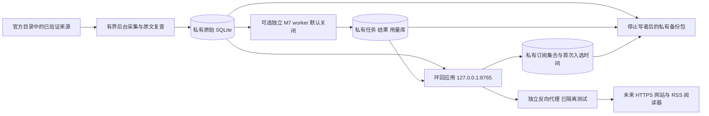

# M9 公开只读网站/RSS 部署准备（Issue #14）

当前结论：设计、离线工具与**现有服务器上的隔离演练已通过，尚不具备公网部署放行条件**。用户随后明确授权使用既有服务器资源，已完成 Linux 全量 979 项、原生 Nginx/TLS 链路 49 项与 Windows 经 SSH 的跨机 RSS 增量检查；现有生产服务状态前后一致，测试进程/端口已关闭。完整证据与限制见 [M9 服务器验收](M9_SERVER_RESULTS.md)。#6 仍缺真实手机/同 Wi-Fi LAN 与使用者反馈；CDU 公开入口的地区/域名条件和来源使用规则待核对。

候选参数与待确认项见 `deploy/m9/targets.example.json`，默认采集关闭、模型关闭、付费模型预算 0、公网监听关闭。它是审核用设计文件，不是会被程序自动读取执行的配置。#13 的 RSS 契约见 [RSS_V1.md](RSS_V1.md)，#6 当前进度见 [电脑端记录](M5C_DESKTOP_RESULTS.md)。

## 最小拓扑与信任边界



最初保持单机、本地磁盘、单个应用发布器、一个原始库和一个共享 M7 队列；不引入 PostgreSQL、微服务或多副本。原始网页、附件、模型返回内容均是不可信输入；官方域名也不能代替当前目录和正文哈希检查。外部请求只能读取公开投影，不能传入采集 URL、模型地址、SQL、数据库路径或文件名。

角色分为通知来源、采集器、可选模型 worker、应用发布器、反向代理、私有运维人员及普通阅读器。采集器写原始库；worker 只读原始库、仅写私有队列；应用会登记自动发布时间和精选状态，因此需要自己的私有数据写权限；代理完全不需要原始库、队列、状态、密钥或备份的文件权限。私有运维命令不挂成 HTTP 路由。

| 威胁/故障 | 当前控制与设计 | 仍需验证 |
| --- | --- | --- |
| 任意文件/管理面暴露 | 代理精确 location 白名单，无 root/alias/静态目录；应用自身只公开投影 | 本次原生路由/部分错误编码已测，更多编码组合仍需复核 |
| 旧来源、撤回、过期或旧模型结果 | 原文 72 小时核验、read_gate、精选集合指纹；失效关闭，无旧 XML/304 回退 | 代理/短时 SSH 订阅已测；第三方 GUI 阅读器长期行为待测 |
| 消息/网页注入和模型错误 | 原文引用复核、原文摘要转义、无工具模型；模型不能授予发布许可 | 不宣称规则能识别所有恶意内容或人工效果通过 |
| 请求洪泛、慢客户端及 SQLite 锁 | 有界连接、请求桶、超时、失败退让；不在请求内采集/调模型 | 突发限流、慢请求头已测；容量和慢响应读取/共享锁压力待测 |
| 错误的本地上游/服务劫持 | 固定环回端口、独立账号、启动时验证公开契约头和 MIME | nginx 本身不执行 LAN 代理的 JSON 字段检查；启动核验不可省略 |
| 备份损坏、缺状态、错库或旧快照 | 三库清单、SHA-256/quick_check、身份复核；恢复只到新目录 | 原生私有目录恢复已测；灾难恢复窗口、独立介质与加密待定 |
| 请求/凭据/访问日志泄漏 | 不转发 Cookie、Authorization、Origin、转发头，不启用访问日志；不发布私有日志 | 严重错误日志脱敏与适用的留存要求 |

## 路由、代理与 TLS 草稿

`deploy/m9/nginx.conf.draft` 是完整的审阅草稿，仅激活 `127.0.0.1:8870`；`nginx.tls.server.draft` 未被默认 include，仅设 `127.0.0.1:9443 ssl` 和必须替换的证书占位路径。没有可直接使用的生产域名或公网监听。已在获授权的私有非生产目录用现有 nginx 完成配置/HTTPS 演练；该实例已停止，默认草稿仍无公网监听。

公开精确路由为 `/`、`/app.css`、`/app.js`、`/favicon.svg`、JSON v1/v2/v3、`/feed.xml`、`/current.xml`、`/history.xml`、两条 `/rss/v1/*.xml`、最小 `/health` 和继续返回 410 的 `/approved.xml`。查询参数由应用严格校验；不为目录、数据库、.env、日志、队列、原始全文、模型配置、质量报告或管理命令开入口。`validate_m9_design.py` 将白名单与当前代码导出的路由集合比较，防止文档/草稿遗漏接口。

草稿只允许 GET/HEAD；未知路径 404、写方法 405、非法 Host 403。代理固定到 `127.0.0.1:8765`，保留原始查询和条件 ETag，不从请求变量构造上游。默认不转发请求头/正文，仅明确转发必要的 Host、Connection、Content-Length 与 If-None-Match；不信任客户端提供的 X-Forwarded-For。未来若增加真正的外层负载均衡/CDN，必须重新定义可信代理网段和头覆盖规则，不能直接开启 real_ip。

Cookie、Authorization、Origin/Referer 不是普通 RSS 的前提。页面相对 API URL 通过同一来源访问，保持应用 CSP、转义与来源约束；不加入跨域凭据/CORS 通配。系统无公开写接口，不能把现有只读部署设计直接扩展成带账号写接口的 CSRF 方案。

外部缓存关闭，强制 `Cache-Control: no-store, max-age=0`，不允许 CDN、proxy cache、stale-if-error、静态错误页或重试到旧实例兜底。200 空集合/覆盖不完整/503 的区别继续由应用决定；ETag 只在本次门禁通过后可 304。网关连接错误和超时设计为固定 503，429/503 配 Retry-After；不把上游 503 变成空 RSS 200。代理和已经收到数据的客户端之间不是跨进程原子事务，已经交付的条目不能远程撤回。

不缓存和同步传输的语义依据 [nginx proxy 模块](https://nginx.org/en/docs/http/ngx_http_proxy_module.html)；请求桶使用其[限流模块](https://nginx.org/en/docs/http/ngx_http_limit_req_module.html)，TLS 草稿参考 [SSL 模块](https://nginx.org/en/docs/http/ngx_http_ssl_module.html)。Windows 准备阶段只做定点静态检查；后续服务器已实际完成 `nginx -t`、证书验证与运行验收，Nginx 1.18 的默认日志权限诊断保留在验收记录中。五类临时文件使用相对于隔离 `-p` 前缀的 `temp/*`，不依赖系统目录写权限。

TLS 后续需核对证书 SAN、链、私钥权限、到期告警、续期和失败保留流程，允许 TLS 1.2/1.3。证书和私钥均在代码仓库之外；不通过忽略证书错误来验收。只有上线另行获准、域名与地区条件核实后，才将经验证的域名/TLS 方案映射到实际入口；草稿不配置明文公网重定向或自动申请证书。

## 并发、预算与资源

原始库与私有队列/订阅库使用 DELETE/TRUNCATE/PERSIST 回滚日志；当前响应门禁拒绝 WAL，不为提升吞吐自行切换。HTTP 在 SQLite 读事务内复核并保持到写出完成，慢读者会影响写者；超时、门禁锁等待和 503 是当前有界退让方式，不能据此承诺零失败或外部 exactly-once。

| 工作 | 初始预算/界限 | 说明 |
| --- | --- | --- |
| 应用 | 单实例、8 个处理连接、socket 超时 5 秒；门禁锁等待 0.1 秒，默认刷新 10 秒/max-age 30 秒 | 原始库读计划仍按全量数据计算，数据增大必须实测，不靠提前分布式化掩盖 |
| 新 RSS | 100 条、1 MiB；全进程请求桶容量 60、每秒补 1 | 不为每种筛选增加独立额度或无界缓存 |
| 网关草稿 | 单 worker/64 连接；每 IP 4 个活动请求、全服务 8 个；2 r/s 每 IP 与 8 r/s 全局，burst=20 | 首次页面资源有突发预算；原生短时突发已验证 429；持续容量仍待校准 |
| 采集 | 草稿关闭；未来复用已有受控采集线程/复查调度，间隔至少 60 秒，通常 3600 秒；默认每轮 48 请求、3 条/来源、3 条原文复查，源请求间隔 2.5 秒、timeout 12 秒、无内部重试 | HTTP 永远不能触发采集。采集与 HTTP 共享进程但预算/线程独立，尚不等于完全 CPU/锁隔离 |
| 模型 | 默认关闭，预算 0，不部署 `--send` worker、不读 Key | 未来需明确提供商、配置版本、单价/币种及其服务端硬限额；本地 Token 预留不是账单上限 |
| 私有 worker（未来） | 共用一个 M7 队列；请求/Token/重试有界，现有参考配置为 20 请求/200000 预留 Token/24 小时 | 新配置或恢复不能清零旧用量；出现未知用量仍占预算，认证失败停止批次 |
| 测试资源 | 复用既有 4 CPU/约 3.3 GiB 主机；pytest MemoryMax=768M、原生链路 512M，均 CPUQuota=75% | 已完成顺序隔离测试，未新购资源；不是生产容量承诺。持久服务草稿资源与瞬时测试不同 |

保持当前 SQLite 单写者竞争模型：采集/发布时间登记需要原始库写事务，模型不持原始库写事务；锁等待超时就保留旧原始数据并停止其有效发布或稍后重试，不伪造健康时间。若原生测试显示共享进程采集明显影响响应，再把已有 `collect_cycle` 包装成单独受控任务；不是现在引入新数据库或微服务。

`cdu-radar.service.draft` 没有安装/enable 操作，无 `[Install]` 自动启用项，需非生产标识文件才允许启动；默认 `--collect-interval 0` 且无模型配置。未来 Linux 使用独立账号、UMask 0077、私有 `/srv/cdu-radar/private/` 与只读版本化代码；本次使用独立私有目录与同类受限瞬时单元实测；该服务草稿本身未安装或 enable，不能把瞬时单元通过称为持久生产服务已验收。

## 监测与故障处理

默认不采集学生身份、Cookie、浏览轨迹或个人偏好；不新增第三方统计。监测由私有固定路由探针和已有 [quality-report](QUALITY_REPORT.md)、M7 `status/ledger` 完成，不发布私有报告作为静态网页。

| 指标 | 初始判定与动作 |
| --- | --- |
| `/health` 与固定公开 Feed | 连续 3 次 503 或无法连接，提示操作员；错误探针只记录路由类别、状态、耗时和时间，不记录用户查询/标识 |
| 来源健康/采集 | 看 `source_health.latest_attempt_failed`、`success_unverified_or_expired` 与单来源最后成功时间；采集连续失败或超过 48 小时提示，超过 72 小时自然停发，不延长最后成功检查 |
| 合格条目突降/全为空 | 同时看 `snapshot.qualified` 和 `snapshot.excluded`、每来源状态；`health.ready` 不代表来源新鲜、当前机会非零或模型完整，不把健康空集合当故障 |
| 模型覆盖与费用 | pending/failed/过期租约/等待预算按原因分开；未知费用不是 0。未批准模型时不启动、不发送探测请求、不扫描环境凭据 |
| RSS 429/503 与响应耗时 | 汇总固定探针及网关计数；异常持续时减少采集/停用模型，不能关闭质量门禁或加入旧缓存 |
| 磁盘/内存/备份 | 私有磁盘剩余 <20% 或数据库/队列异常增大时检查；剩余 <10% 停止非必要写入并人工处理，不能自动删除原始数据/账本；备份完成需检查清单及恢复结果 |
| 证书与配置 | 后续 TLS 提前 14 天告警；续期失败保留现有受控配置，临近失效时停止该入口，不忽略 TLS 校验 |

当前不新增后台监控进程/定时任务或对外通知。访问日志关闭；严重错误日志只在私有、轮转、受限的目录保留，可能包含请求上下文，导出前必须脱敏。法律适用、日志留存和来源使用要求尚待具体目标审查，不能宣称此日志默认值已满足所有要求。

## 备份、恢复和版本回滚

新增 `scripts/backup_state.py`，调用包内 `cdu_radar.backup_state`。这是离线运维工具，不创建远程连接、部署服务或修改现有源库。

1. 维护窗口先停止采集、模型 worker 与应用发布器，核实所有写者停止，再显式 `--quiesced`。工具不会代替操作员停止进程；它会获取既有 publisher OS lease，拒绝活跃发布器，并持有各 SQLite 的只读回滚快照。多个库不是一个分布式事务，跨库一致性仍以前置的写者停止为条件。
2. 新备份目录保存 `raw.sqlite3`、可选 `jobs.sqlite3`、可选 `subscriptions.sqlite3` 与清单，逐库 quick_check、大小和 SHA-256 校验，验证队列/订阅来源身份。拒绝 WAL、错误类型、符号链接、重复角色/条目、超过 512 MiB 的单库、已存在输出和状态目录内输出。原库和队列/订阅数据的哈希必须保持。
3. 只备份这些明确数据文件，不自动复制 `.env`、Key、私钥、整目录、日志、publisher.lock 或缓存 XML。代码 wheel 与经审核的非秘密配置单独按版本归档；备份包含原始全文和内部状态，始终私有，不能放到网关目录。清单是校验记录，不是抗恶意篡改签名；私有介质、离线副本和加密策略在目标确定后实施。
4. 恢复先核验清单、允许文件名、长度、摘要、SQLite 和来源身份，再创建**全新独立目录**。不覆盖已有文件、不恢复进原备份目录。仅在新副本重建 M7 的路径/文件身份、发布器 owner 和订阅来源绑定，保留原始行、核验时间、GUID、首次聚合、首次入选、任务和用量/未知预留。旧精选 collection 清空，发布器下次必须重验，绝不直接服务旧 XML。
5. 恢复目录必须是最终固定的真实路径，之后不要移动/改名或经符号链接切换私有数据；否则绑定会失效。未来非生产服务应明确指向该恢复目录，逐项核对 raw/analysis/state 路径和 systemd ReadWritePaths，并验证文件属主/权限适合服务账号；保留原目录供调查。代码的版本切换与私有数据路径是两件事。
6. 先用相同 wheel 与非秘密配置、关闭采集/模型验证恢复；恢复不会伪造当前来源检查。超过 72 小时的备份仍会被正常排除，模型结果也会按输入/配置重新验证。备份后新入选时间或新请求账本可能不在包内，不能承诺零损失。
7. 模型恢复后仍默认关闭。先把备份之后的潜在付费用量与提供商记录核对，在服务端设置硬额度；不能利用恢复旧队列绕过预算。未知/在途任务与租约由原机制处理，不手工伪造为成功或批准。

以下仅演示此前 Windows 阶段**隔离合成数据**的命令；后续 Linux 演练使用服务器独立合成库，两者均不指向既有生产数据：

```powershell
.\.venv\Scripts\python.exe scripts/backup_state.py backup --raw-db artifacts/m9-preparation-20261017/synthetic.sqlite3 --state-dir artifacts/m9-preparation-20261017/http-state --analysis-db artifacts/m9-preparation-20261017/synthetic-jobs.sqlite3 --output artifacts/m9-backup-new --quiesced
.\.venv\Scripts\python.exe scripts/backup_state.py restore --bundle artifacts/m9-backup-new --output artifacts/m9-restored-new
```

SQLite 副本通过标准 [Connection.backup](https://docs.python.org/3.12/library/sqlite3.html#sqlite3.Connection.backup) 生成；这里额外要求停止写者、回滚读快照和跨文件身份验证。默认没有自动清理备份。初始计划每次升级前及每个明确维护窗口保留新包，至少留最近一次可验证恢复的包与上一版本包；RPO/RTO 尚未实机验证，不承诺 SLA。

代码升级计划为：核对依赖与变更 → 停写/完整备份 → 在新只读发布目录安装指定 wheel → 隔离验收 → 经授权切换代码并小范围观察。仅兼容代码回滚时保留最新数据和用量，不用旧数据包覆盖当前账本；不兼容数据版本必须恢复到新的固定目录并对账后另行切换。降级目标无法读取当前 schema 时停止服务，不能强改 PRAGMA 版本或删除新表。

密钥默认不在备份包中。未来轮换顺序为：提供商建立受限新凭证 → 私有服务环境替换 → 经单独授权的最小验证 → 撤销旧凭证 → 留脱敏操作记录。配置中只使用 key_env 名称；HTTP 不接收或回显 Key，变更凭证不抹掉旧预算。TLS 私钥、SSH 凭据和模型 Key 分别管理。后续服务器验收仅使用本机既有 SSH 身份并新建私有测试自签证书；没有导出 SSH 私钥、读取模型 Key 或轮换生产凭据。

## 域名、地区、来源与非官方声明

已根据用户指定档案连接既有服务器，仅作为隔离测试资源；档案的地域信息不等于已确认 CDU 公开入口的接入条件。主办主体、公开域名归属、服务用途与具体接入地区仍需逐项确认，不将同机测试当成已有公网部署。境内非经营性互联网信息服务的备案流程需按具体接入地、主办者及服务内容核实，官方[办事指南](https://zjca.miit.gov.cn/bsfw/bszn/fjyxhlwxxfwbahz/art/2020/art_27ba712270224ad2a6a9db8e7703dfb9.html)给出了相关前提。此处只列核实项，不据此断言本项目已经满足备案、前置审批或其他所在地要求；地区不同也不能自动推断无需任何手续。

来源逐项核对 robots、访问频率、站点使用/转载条款、摘要范围、署名和更正/撤回方式；当前只继承已有来源可信与抓取约束，没有证明所有来源允许未来公开再分发。现有公开摘要直接采用原文节选，需要核对是否包含学生名单/个人联系方式，不能把模型输入脱敏当成公共摘要已脱敏的证据。页面逐条保留官方原文和发布单位，不复制校方身份、账号或官方背书。

上线设计要求页面明显展示“非成都大学官方服务；内容来自各通知所示官方来源，完整要求以原文为准”，对应候选文案在 targets 文件中。当前页面已有来源/分类边界说明；新增醒目的非官方声明作为未来公开版本放行核对项，不把文案存在设计文件等同于已经在公网展示。

## 放行与停止条件

| 门槛 | 当前状态 | 后续动作 |
| --- | --- | --- |
| #4 CI | 基线 `8e29999` 的 Windows/Ubuntu × Python 3.11/3.12 四项成功 | [实际 Actions run](https://github.com/A7m0spHere/cdu-opportunity-radar/actions/runs/38935608765)；本轮新改动还没有远端 CI，旧成功不覆盖新变更 |
| #6 第二设备/手机及 Linux 原生 | Linux 原生与受控 SSH 跨机通过；手机/同 Wi-Fi LAN/使用者反馈未完成 | [服务器记录](M9_SERVER_RESULTS.md)，保留设备体验待验收 |
| #13 RSS 契约 | 基线已提交/推送，本地及原生 Nginx/TLS/跨机增量通过，issue 状态尚单独维护 | 第三方 GUI 阅读器长期行为待测 |
| 静态策略、离线恢复与原生链路 | Windows 准备与服务器原生验收均通过 | 测试为合成数据/Mock；不代替实际内容和持续运行验收 |
| 目标地区/域名/来源规则 | 未确认 | 由实际主办者与目标接入方核实并记录 |
| 隔离非生产部署演练 | 按用户授权在既有服务器私有目录完成并停止 | 同一物理资源，测试实例独立；既有服务快照前后一致，不修改现有服务 |
| 真正公开上线 | 未获授权 | 只有明确目标、全部验收证据和单独上线授权后实施 |

本次非生产验收已记录系统/原生链路与停止情况，仍需补长期阅读器和旧代码升级/降级演练。每次后续验收应继续记录：系统/Python/nginx/OpenSSL 版本、原生安装、`nginx -t`、只读/私有路由、Host/请求头、TLS 正常与失败、304/空200/503/429、实际 RSS 阅读器增量、源撤回与72小时失效、限流/慢读者、备份恢复、版本回滚及停止后端口关闭。每项使用通过/失败/未执行/不适用，记录命令、脱敏结果和复现问题。

遇到原文/数据库失效时保持失败关闭；遇到未授权公开监听、私有路由暴露、状态错库、TLS 验证失败或无法回滚时停止该演练入口并保留证据。Windows 离线工具不会自动部署；服务器阶段由操作员显式启动并停止独立测试实例，没有安装/enable 持久服务、真实采集、调模型或发送业务通知。

Windows 阶段见 [M9 准备验收记录](M9_PREPARATION_RESULTS.md)，最新阶段见 [M9 服务器验收记录](M9_SERVER_RESULTS.md)。
