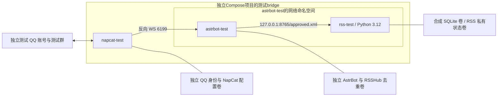

# M3-B.1：测试资源盘点与隔离部署设计

> **归档（2026-11-03）**：本文是历史证据，内容逐字保留归档时的原文，仅把相对链接路径更新为归档后的位置；描述的是当时状态，**不代表当前实现或当前状态**。当前入口见 [docs/README.md](../README.md)。

设计日期：2026-10-15。本轮没有服务器访问授权，**远程连接、镜像拉取/构建、容器创建、服务启动、QQ 登录/发送均为 0**。文件是待审批草稿，不代表部署完成，不更新 M3-B 真实联调验收状态。

## 1. 证据与当前阻塞

唯一服务器现场依据为第一阶段 2026-10-15 11:34:39 的只读报告：Ubuntu 22.04 x86_64，Docker 26.1.3、Compose 2.27.1，宿主默认 Python 3.10.12、SQLite 库 3.37.2；现有 AstrBot/NapCat 健康。当时共发现 4 个容器，未确认独立测试实例，也未深入检查网络、卷或插件。本轮没有重新登录，不能把旧清单当作当前完整清单。

| 前置项 | 当前结论 |
| --- | --- |
| 可复用测试实例 | **未知**；已有证据只支持“未确认”，不支持“不存在” |
| Compose 项目名称、宿主剩余内存/磁盘 | **未知**，待新只读授权 |
| 测试实例网络/持久化 | **未知**；须先明确实例身份再检查 |
| 独立 QQ 测试账号/测试群 | **未提供、未确认，真实 QQ 联调 blocked**；不借用生产身份 |
| 固定镜像 digest / 测试 RSSHub 版本 | 待审批选择；草稿故意没有可自动回落的 latest |
| 项目运行时 | 用独立 Python 3.12 RSS 镜像，保持宿主 Python 原样 |

## 2. 下次授权的最小只读盘点

以下命令**本轮未执行**。下一次只请求批准：对先前已确认的同一主机执行下列 R1；如出现用户明确认领的测试实例，再批准/执行 R2。不读取环境变量、聊天数据、插件配置、密钥或完整 inspect，不调用 OneBot API。

R1：容器名称/镜像/状态/Compose 项目标签，以及可用内存和两个相关文件系统的剩余空间。不用 compose ls 的原始 JSON，以免输出无关配置文件路径。

```bash
docker ps -a --format '{{.Names}}\t{{.Image}}\t{{.Status}}\t{{.Label "com.docker.compose.project"}}'
python3 - <<'PY'
from pathlib import Path
import json, os
mem = {}
for line in Path('/proc/meminfo').read_text().splitlines():
    k, v = line.split(':', 1)
    if k in {'MemTotal','MemAvailable','SwapTotal','SwapFree'}:
        mem[k+'_KiB'] = int(v.split()[0])
space = {}
for name in ['/', '/var/lib/docker']:
    if not Path(name).is_dir():
        space[name] = {'status':'not_found'}
        continue
    s = os.statvfs(name)
    space[name] = {'available_bytes':s.f_bavail*s.f_frsize,
                   'total_bytes':s.f_blocks*s.f_frsize,
                   'device':os.stat(name).st_dev}
print(json.dumps({'memory':mem,'filesystems':space}, indent=2))
PY
```

Docker Root Dir 如不在 `/var/lib/docker`，本次只报告该项未知，不自行扫描磁盘；下一次确认实际存储路径后才能评估镜像容量。两个路径可能同一文件系统，不能把剩余空间相加。容器名字或 Compose 项目含 test 不足以认定可复用，须用户确认账号、用途及与生产目录无共享。没有明确测试实例就停在这里。

R2：只针对已经确认的测试容器与项目。两个占位必须人工替换，不填生产 astrbot；输出仅限网络与挂载结构，不输出任何 Env、配置或标签全集。

```bash
TEST_ID='USER_CONFIRMED_TEST_CONTAINER_ID'
EXPECTED_PROJECT='USER_CONFIRMED_TEST_COMPOSE_PROJECT'
actual_project="$(docker inspect --format '{{index .Config.Labels "com.docker.compose.project"}}' "$TEST_ID")"
test "$actual_project" = "$EXPECTED_PROJECT" || exit 3
docker inspect --format '{{.Name}} network={{.HostConfig.NetworkMode}}' "$TEST_ID"
docker inspect --format '{{range $n,$v := .NetworkSettings.Networks}}{{$n}} ip={{$v.IPAddress}} {{end}}' "$TEST_ID"
docker inspect --format '{{range .Mounts}}type={{.Type}} source={{.Source}} destination={{.Destination}} rw={{.RW}} {{end}}' "$TEST_ID"
```

如果实例不是 Compose 管理，或项目标签与认领信息不一致，停止并补充确认，不能绕过上面的匹配。挂载源路径只在本地私有报告中核对，分享时隐藏个人路径。无测试实例时不对生产容器执行 R2；本轮也不再尝试识别任意 Python 进程或读取 compose 文件来寻找凭据。

## 3. 推荐架构



RSS 使用 `network_mode: service:astrbot-test`，不是生产容器的 `container:astrbot`，不同时声明 networks。该 Compose 语义见 [Docker services 文档](https://docs.docker.com/reference/compose-file/services/#network_mode)。AstrBot 通过自己的环回访问 RSS；NapCat 走专属 bridge 的 DNS 名 astrbot-test，不能把 NapCat 的 localhost 当作 AstrBot。

专属 bridge 允许测试 QQ 必需的出站连接，不设 internal=true，也不添加生产外部网络。**这提供独立网络命名与数据隔离，不是主机/公网访问的硬防火墙**；容器仍可能访问宿主已发布端口。若要求严格出站 ACL，需额外设计并授权，不能声称本草稿已隔绝一切生产网络访问。

草稿文件：

- [compose.draft.yaml](../../deploy/m3b1/compose.draft.yaml)：独立项目 cdu-radar-m3b-test、AstrBot、NapCat、RSS 与一次性 rss-init，默认没有启用的 profile，也没有宿主端口映射。
- [compose.admin.draft.yaml](../../deploy/m3b1/compose.admin.draft.yaml)：可选管理覆盖，只映射宿主 127.0.0.1:16185→AstrBot 6185、127.0.0.1:16099→NapCat 6099；启用前另批端口占用检查、绑定和 SSH 管理隧道。不发布 RSS 8765 或 OneBot 6199。
- [Dockerfile.rss](../../deploy/m3b1/Dockerfile.rss)：Python 3.12、非 root UID 10001、只复制包与必要元数据，显式安装 tzdata；根文件系统只读，写入只在两个专属卷和受限 tmpfs。构建期安装依赖会访问软件源，必须在拉取/构建阶段单独获批，当前未执行。
- [.dockerignore](../../.dockerignore)：默认拒绝构建上下文，仅放行上述必要源码，避免将 data、artifacts、.env、Git 历史或凭据发给构建器。

全部服务 `pull_policy: never`、`restart: "no"`，只在已批准且已备妥镜像后明确启动。profiles 只是分组，显式指定服务可以绕过 profile，不是权限机制；YAML 文件也不会阻止管理员误操作。

## 4. 版本、身份和卷契约

必填变量：ASTRBOT_TEST_IMAGE、NAPCAT_TEST_IMAGE（经审核的镜像 @sha256 digest）；PYTHON_BASE（经审核的 python:3.12-slim-bookworm@sha256 digest）；RADAR_TEST_IMAGE（本次源码构建的独立本地标签，记录 image ID/源码提交）；NAPCAT_TEST_WEBUI_TOKEN（全新测试 UI token）。未填写时 Compose 插值应失败，不替换成生产值或 latest。当前没有生成 token、凭据文件或 QQ 身份。

实际配置校验用私有输入文件及 `docker compose ... config --quiet`，不要打印完整渲染配置；未启用 qq profile 也可能校验它的变量，不能把变量检查误当成 NapCat 已启动。本机无 Docker CLI，尚未执行 Compose config、Dockerfile build 或 Linux 容器验证。PyYAML 静态检查不替代它们。

上游 [AstrBot Compose](https://github.com/AstrBotDevs/AstrBot/blob/master/compose.yml) 给出 /AstrBot/data 持久目录。[NapCat-Docker 文档](https://github.com/NapNeko/NapCat-Docker) 给出 QQ、配置、插件三个目录，以及 reverse_ws / ONEBOT_URL；草稿采用 `ws://astrbot-test:6199/ws`。所选具体镜像须核对该模式支持，AstrBot 测试平台须人工配置监听 0.0.0.0:6199 的相应 /ws 路径并确认认证匹配。Compose 不自动替管理员配置 OneBot，不假设旧 v4.15 镜像已支持当前文档所有参数。

测试实例不装生产定制补丁，不导入 provider 配置、LLM Key、人格、群历史或 NapCat 会话。安装 RSSHub 后确认 bootstrap_skip_history=true、继承 handlers 为空，不启用 AI、Routes 知识库、学习或其他会触发付费调用的插件。首轮先做纯文本，关闭无关媒体下载。WebUI/OneBot 所需测试凭据以后私下配置，不能把默认口令作为验收通过；只有 fresh UI token 并不能证明 OneBot 已认证。

| Compose 卷键（均有项目名前缀） | 仅挂载给 / 目标 | 隔离核查 |
| --- | --- | --- |
| astrbot-data | astrbot-test /AstrBot/data | 新空卷，保存测试插件与配置，不导入生产 |
| rsshub-data | astrbot-test /AstrBot/data/plugin_data/astrbot_plugin_rsshub | 独立去重/失败历史卷；不得仅挂插件源码而丢失数据库 |
| synthetic-data | rss-init、rss-test /var/lib/cdu-lab | 仅合成 dataset/synthetic.sqlite3 与实验标识 |
| rss-state | rss-test /var/lib/cdu-rss-state | 私有 XML 与单写者锁，绝不能作静态目录发布 |
| test-qq-identity | napcat-test /app/.config/QQ | 仅独立测试 QQ，不拷贝生产会话 |
| napcat-config | napcat-test /app/napcat/config | 新配置，不挂生产配置 |
| napcat-plugins | napcat-test /app/napcat/plugins | 空测试插件卷 |

所有卷由该项目创建，既不 external 也不指定现有卷 name，测试目的标签明确；不得用 -p 改成生产项目名。部署前先只读确认固定项目名及这七个默认卷名没有既有资源，重名时停止，不能用 up 接管。桥网络同样不得与既有项目混用。

RSSHub 路径基于固定参考提交 a047f46 的 [paths.py](https://github.com/AstrBot-Elementary-School/astrbot_plugin_rsshub/blob/a047f46e47cb2a0f7a795f30b9f82ae027005846/src/infrastructure/utils/paths.py)，现场安装后还须确认实际数据库路径确实落入 rsshub-data 卷，不能落到 /tmp 回退。插件有自己的日志模式，不得与 Radar 数据库混同；Radar 新库须独立核实 v5 且 journal_mode 为 delete/truncate/persist，不强制修改未知库。

新卷默认不复制 AstrBot/NapCat 镜像目录内容；所选镜像如果依赖预置 /data 文件，需要先审查镜像初始化约定，而不是拷生产配置补缺。RSS 两个卷依靠专用镜像目标目录的 UID 10001 初始化所有权；现场须确认可写，不能为图省事改 root/privileged 或 chmod 777。

## 5. 资源预算（估算，非实测）

| 服务 | 预计常驻内存 | 草稿内存上限 | CPU 上限 |
| --- | --- | --- | --- |
| AstrBot（仅 RSS，关闭模型/额外插件） | 300–600 MiB | 768 MiB | 0.75 核 |
| 独立 NapCat + Linux QQ | 800–1600 MiB，登录峰值可能更高 | 2048 MiB | 1.0 核 |
| RSS Python 3.12 | 30–100 MiB | 256 MiB | 0.25 核 |
| rss-init（一次性，不与正常高峰并跑） | 小于 RSS 预算，待实测 | 256 MiB | 0.25 核 |

三常驻容器总 cap=3 GiB、CPU cap=2 核；NapCat shm_size=256m 属于内存使用预算，不是免费额外内存。上限不能保证启动成功或性能；达到上限 OOM 时停止排查，不能自动放大。完整环境建议 MemAvailable 至少 4 GiB（含约 1 GiB 余量），RSS+AstrBot 先行阶段至少 1.5 GiB；不能用 SwapFree 代替物理可用内存，也不把内存上限之和当作实际占用。

建议 Docker 存储文件系统至少预留 15 GiB，20 GiB 更稳妥：镜像/解压/构建缓存估 8–12 GiB，测试卷/QQ缓存预留 2 GiB，证据及余量 1–3 GiB；实际 digest 对应大小未知，未拉取。每个容器 stdout 日志按 10 MiB×3 轮转，三个常驻约 90 MiB；应用自身卷内日志/QQ缓存另算，普通 named volume 无容量配额。试验限定短期并人工检查增长，不自动 prune 镜像或删除生产日志来腾空间。

上次未读取剩余内存和磁盘，**当前服务器能否承载未知**。如果不满足余量，先换独立测试机/扩容方案并审批，不压缩生产资源强行上线。

端口预算：基础方案新增宿主监听 0、无公网入口；命名空间内部 8765（RSS）、6185（AstrBot UI）、6199（OneBot）及 NapCat 6099。可选管理覆盖才增加两个宿主环回监听；端口冲突检查不在本轮执行。QQ 出站依赖 DNS 与腾讯服务可达，当前未验证，不擅自更改防火墙。

## 6. 分阶段实施与回滚（全部待授权）

| 阶段 | 精确操作范围 / 进入条件 | 回滚 / 停止 |
| --- | --- | --- |
| R：只读盘点 | 新授权后执行第 2 节 R1；明确认领实例才执行 R2；保存脱敏容量与身份结论 | 不产生服务/卷，结果不明即止 |
| P：备料 | 批准固定项目/七卷/网络名、新源码快照、镜像 digest 和容量后，才拉取两机器人镜像、Python 基础镜像并构建 RSS；记录版本及依赖清单 | 拉取/构建失败即停；不自动 prune，不修改宿主 Python，不启动服务 |
| S：仅 RSS 路径 | 单独批准新卷/bridge/两个常驻测试容器和一次性 init；先 tools 的 rss-init 创建非空合成库，再启动 rss profile 的 astrbot-test/rss-test；NapCat 不启动 | 失败先停 rss-test 再停 astrbot-test，保留全部实验卷与取证；禁止静态 XML 回退 |
| I：插件配置 | 单独批准仅在测试 AstrBot 安装审核过的 RSSHub、配置纯文本无模型，并核对去重卷路径与数据库模式 | 停测试订阅/RSS，保留 history；若要恢复插件版本须连同停机一致性卷快照匹配，不只改镜像 |
| Q：真实 QQ | 独立账号/测试群明确后另批 qq profile 启动、登录、OneBot 接入及管理端口/隧道（如需）；最后另批最多 6 条业务消息及重启/故障演练 | 错误群/重复/模型调用立即停测试订阅及 napcat-test，再停 RSS；已发消息不能由 RSS 撤回 |

S 中 init 使用 /var/lib/cdu-lab/dataset，新目录不存在才允许，拒绝覆盖；init 服务 network_mode=none，没有网络。不要把它作为 rss-test 每次启动的依赖，否则可能重复初始化/错误恢复。服务启动后由测试 AstrBot 自己的运行环境 GET http://127.0.0.1:8765/approved.xml；宿主或 NapCat 的同名 URL不能代替验证。共享命名空间只共享网络，不共享 RSS 的文件卷。

重建 astrbot-test 时须一起停止并按依赖重建 rss-test，再验证 namespace 归属；不能假设旧侧车自动跟随新容器。保留数据库和 RSSHub 去重卷，正常服务重启不重新 init、不伪造 GUID/pubDate。插件订阅从非空一条初始化开始，确认历史建立后才加第二条；不能先订阅空正式 Feed。

需要管理 UI 时再启用 admin 覆盖和经批准的 SSH 转发，不能把绑定改为 0.0.0.0。构建/初始化/配置/登录都各有写入，应审批后分步执行；本轮不把这些命令写成可一键自动执行的部署脚本。

整体回滚只针对 cdu-radar-m3b-test 项目：先停测试订阅/测试 NapCat 与 RSS，再停测试 AstrBot；停机后做七卷一致性备份（含嵌套 rsshub-data，不能只备 astrbot-data）。移除该项目容器/网络需另有清理授权，默认保留卷、QQ会话及历史。禁止 down --volumes、全局 prune 或递归删除宿主目录。备份包含测试凭据仍属私有数据，恢复必须匹配镜像/插件版本；恢复去重状态前不登录发送，避免失败队列重放。

## 7. 本轮离线验收及下一次审批单

运行 `python scripts/validate_m3b1_design.py`（本机已有 PyYAML 的系统解释器，非项目运行依赖），只读取草稿，不访问网络、Docker、SSH 或 SQLite。检查项目/服务、profile、宿主端口、测试 namespace、独立卷、资源限制、构建白名单等隔离契约，并拒绝生产 namespace、生产挂载、公开 RSS 端口、external 去重卷四种不安全变体。结果见交付记录；不是 Compose 官方 schema 或运行验证。未改业务源码，无需重复启动 HTTP 测试服务来验证文档。

本轮实际结果：**44 项静态契约通过，4 种不安全变体全部拒绝**；文档链接及嵌入 Python 语法检查通过，diff 空白检查通过。验证记录保存在忽略的 artifacts/m3b1-design-validation-v1.json。没有运行 Docker config/build/up，也没有启动任何本地或远程测试服务；之前 493 项测试是既有功能基线，本轮没有重跑或据此宣称容器兼容通过。

下一次可单独批准 **R1 最小只读盘点**：在此前目标主机查询所有容器的名称/镜像/状态/Compose 项目标签，读取 MemAvailable 等容量及 `/`、`/var/lib/docker` 文件系统空间；无其他访问。R2 只在用户确认具体测试容器与项目后执行。此审批不包含 P/S/I/Q，不包含镜像拉取、资源创建、插件读取/安装、数据库连接、网络变更或 QQ 操作。

在拿到 R 的证据前，P/S/I/Q 的主机容量、具体镜像 digest、卷名冲突和身份前置仍未满足，不能批准执行含糊的“全部部署”。真实 QQ 联调继续标记 **blocked（独立测试账号及测试群未确认）**，设计与离线交付可完成。仓库当前改动仅本地草稿，不自动提交、推送或更新 PR。
